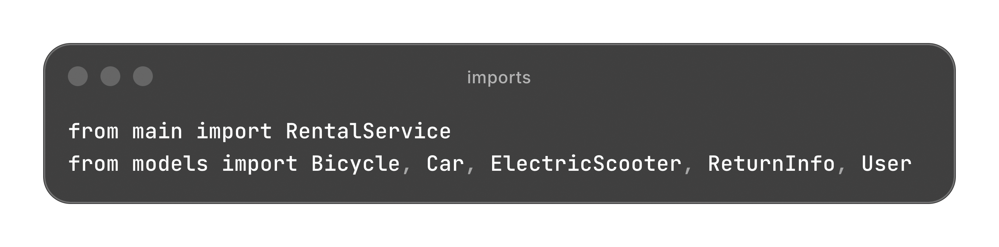
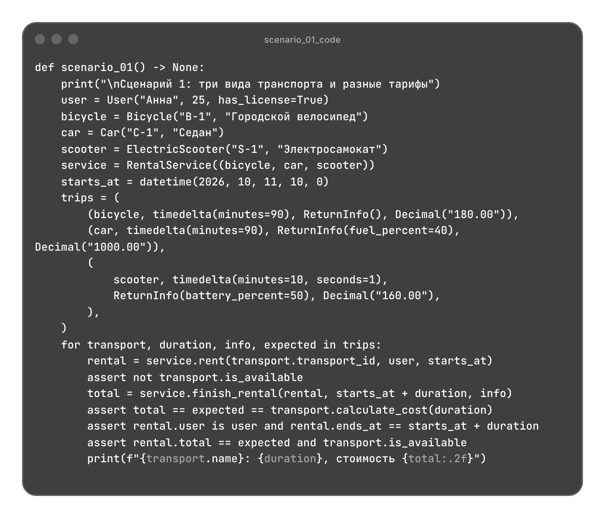
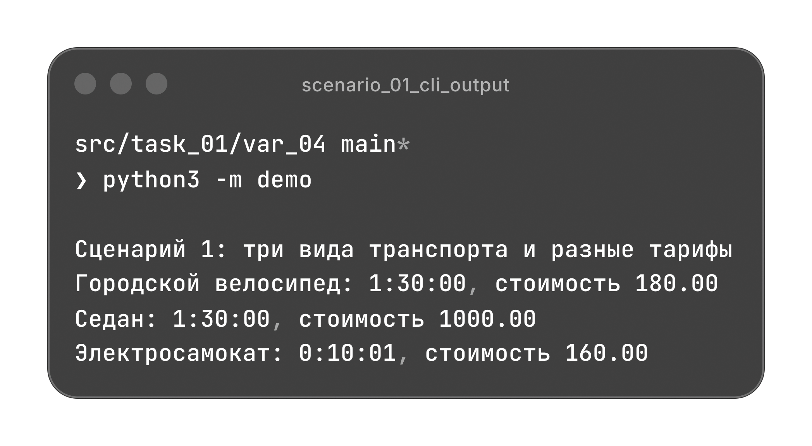
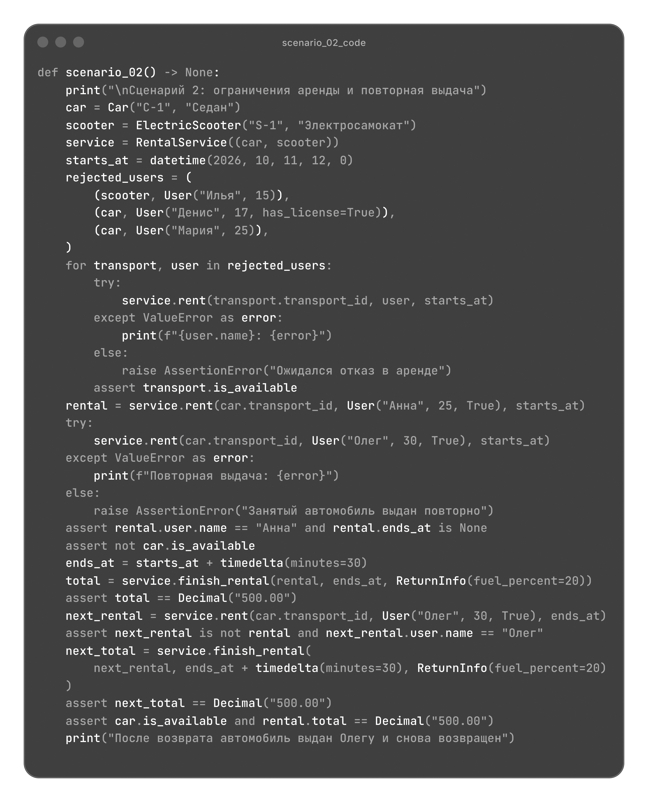
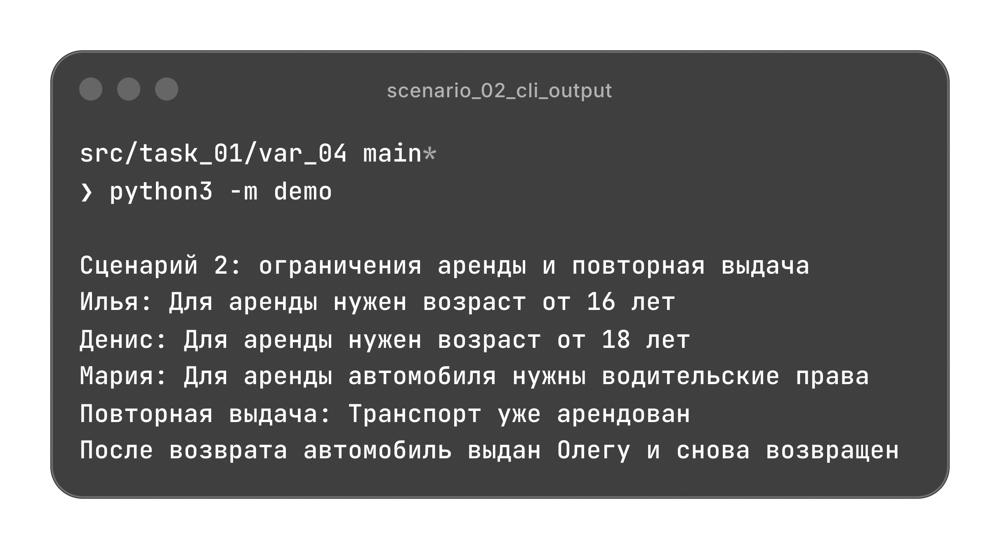
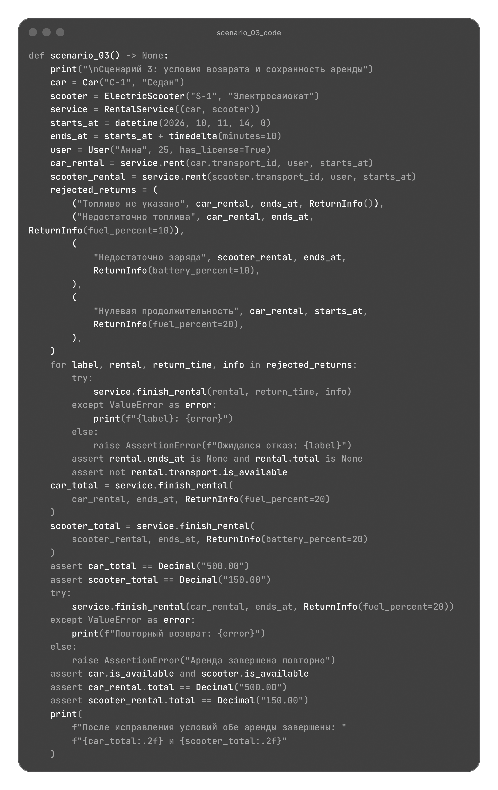
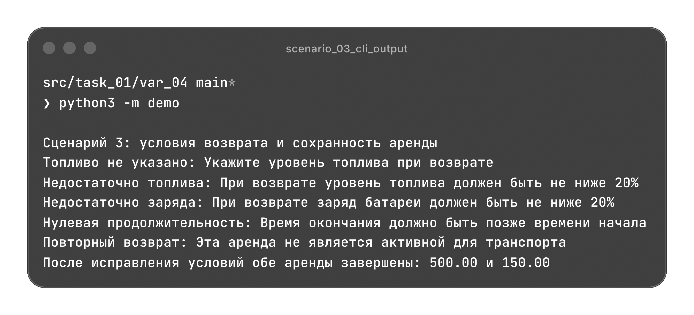

# Прокат транспорта

Аренда велосипедов, автомобилей и электросамокатов, расчет стоимости по времени и возврат с проверкой условий каждого вида транспорта.

[Архитектура](#архитектура) | [Сценарии](#сценарии)

## Архитектура

| Файл | Назначение |
| --- | --- |
| [models.py](./models.py) | Пользователь, данные возврата, аренда и три вида транспорта; тарифы и правила выдачи и возврата. |
| [validate.py](./validate.py) | Проверки входных данных, времени, денежных сумм, ограничений и регистрации. |
| [main.py](./main.py) | Каталог транспорта и координация выдачи и завершения аренды. |
| [demo.py](./demo.py) | Три независимых сценария с проверкой результатов. |

### Модели

Модели используют `dataclass` с `frozen=True` и `slots=True`. Поля защищены от прямого присваивания, предусмотренные изменения аренды выполняются операциями транспорта.

| Класс | Данные |
| --- | --- |
| `User` | Имя, положительный целый возраст и признак водительских прав. |
| `ReturnInfo` | Уровень топлива `fuel_percent` и заряд `battery_percent`; отсутствие данных обозначается `None`. |
| `Rental` | Транспорт, пользователь, начало аренды; время окончания и итоговая стоимость заполняются при возврате. |
| `Transport` | Общие идентификатор и название, закрытая ссылка на активную аренду. |

`Transport(ABC)` задает общий порядок выдачи, возврата и расчета. Каждый вид реализует `_calculate_cost()`, объявленный через `@abstractmethod`, и при необходимости добавляет свои проверки.

### Тарифы и условия

| Вид транспорта | Тариф по умолчанию | Условия выдачи | Условия возврата |
| --- | --- | --- | --- |
| `Bicycle` | `120.00` за час пропорционально фактическому времени. | Дополнительных ограничений нет. | Дополнительных условий нет. |
| `Car` | `500.00` за каждый начатый час. | Возраст от 18 лет и водительские права. | Топливо не ниже `20%`. |
| `ElectricScooter` | `50.00` за разблокировку и `10.00` за каждую начатую минуту. | Возраст от 16 лет. | Заряд батареи не ниже `20%`. |

Тарифы передаются через `Decimal` и могут быть заданы при создании транспорта. Количество начатых часов и минут округляется вверх через `ROUND_CEILING`. Итог округляется до копеек через `ROUND_HALF_UP`. В расчет времени не вводится `float`.

Это паттерн "Шаблонный метод": общие операции находятся в `Transport`, наследники определяют формулу и дополнительные условия. Сервис вызывает единый интерфейс без проверки конкретного вида транспорта.

### Занятость и возврат

`is_available` вычисляется по наличию активной аренды. Общая проверка занятости выполняется в `Transport.rent()` перед проверками конкретного вида. Занятый транспорт нельзя выдать повторно, в том числе через другой сервис с тем же объектом транспорта.

`RentalService.finish_rental()` делегирует возврат единственной операции `Transport.return_back()`. Она проверяет, что передан именно объект текущей аренды, проверяет время и условия, рассчитывает стоимость и затем записывает результат и освобождает транспорт.

При отказе время окончания и стоимость остаются `None`, транспорт сохраняет занятость. После исправления условий возврат можно повторить. Завершенная или самостоятельно созданная копия аренды не может освободить транспорт, включая новую аренду этого же объекта.

### Валидация

`validate.py` не зависит от моделей и сервиса. Он проверяет строки, типы, возраст, признак прав, тарифы, проценты, время, занятость и регистрацию объектов.

Ставки должны быть положительными конечными `Decimal` с точностью до копеек. Плата за разблокировку может быть нулевой. Топливо и заряд задаются целыми числами от 0 до 100; `bool` не принимается как возраст или процент.

Начало и окончание задаются местным временем пункта проката без часового пояса. Окончание должно быть позже начала, продолжительность передается как положительный `timedelta`. Время задается явно, расчеты не зависят от момента запуска программы.

Неверный тип модели, денежного значения, времени или продолжительности вызывает `TypeError`. Некорректные значения и нарушения условий приводят к `ValueError`.

### Сервис

`RentalService` использует `dataclass`. Каталог сохраняется кортежем, идентификаторы транспорта должны быть уникальными. Выдача выбирает транспорт по идентификатору, завершение требует экземпляр транспорта из этого каталога.

Сервис координирует операции. Формулы, дополнительные условия и состояние занятости принадлежат транспорту. Создание `Rental` напрямую не резервирует транспорт; рабочая аренда получается через `rent()`.

Методы RentalService

| Метод | Результат |
| --- | --- |
| `rent(transport_id, user, starts_at)` | Активная аренда после проверки данных, занятости и условий выдачи. |
| `finish_rental(rental, ends_at, info)` | Стоимость типа `Decimal`; аренда завершается и транспорт освобождается после успешных проверок. |

## Сценарии

`demo.py` содержит три независимых сценария. Каждый сценарий создает собственные объекты и проверяет результаты через `assert`.

Импорты demo.py

### Три вида транспорта и разные тарифы

Пользователь "Анна", 25 лет, с водительскими правами арендует все три вида транспорта. Велосипед за 90 минут стоит `180.00`, автомобиль за 90 минут оплачивается как два часа и стоит `1000.00`.

Самокат за 10 минут и 1 секунду оплачивается как 11 минут с разблокировкой, итог `160.00`. После успешных возвратов все объекты свободны, в каждой аренде сохранены время окончания и стоимость.

Код scenario_01()

### Ограничения аренды и повторная выдача

Самокат не выдается пользователю младше 16 лет. Автомобиль не выдается пользователю младше 18 лет или без водительских прав. Отказы сохраняют свободное состояние транспорта.

После выдачи автомобиля Анне попытка выдать его Олегу отклоняется. После возврата с топливом `20%` автомобиль успешно выдается Олегу. Каждая получасовая аренда стоит `500.00`.

Код scenario_02()

### Условия возврата и сохранность аренды

Возврат автомобиля без данных о топливе или с топливом `10%`, возврат самоката с зарядом `10%` и окончание в момент начала отклоняются. После каждого отказа аренда остается незавершенной, транспорт занят.

С топливом и зарядом `20%` возвраты проходят: автомобиль за 10 минут стоит `500.00`, самокат `150.00`. Повторный возврат автомобиля отклоняется, ранее рассчитанная стоимость сохраняется.

Код scenario_03()

