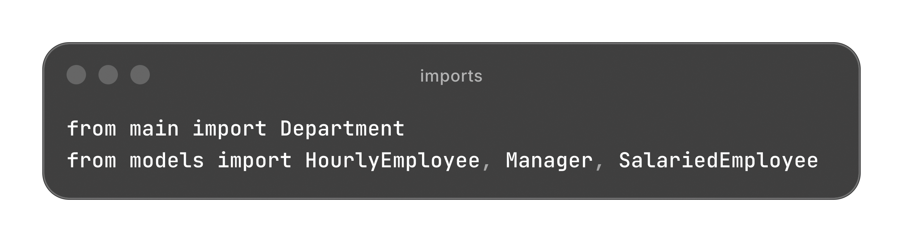
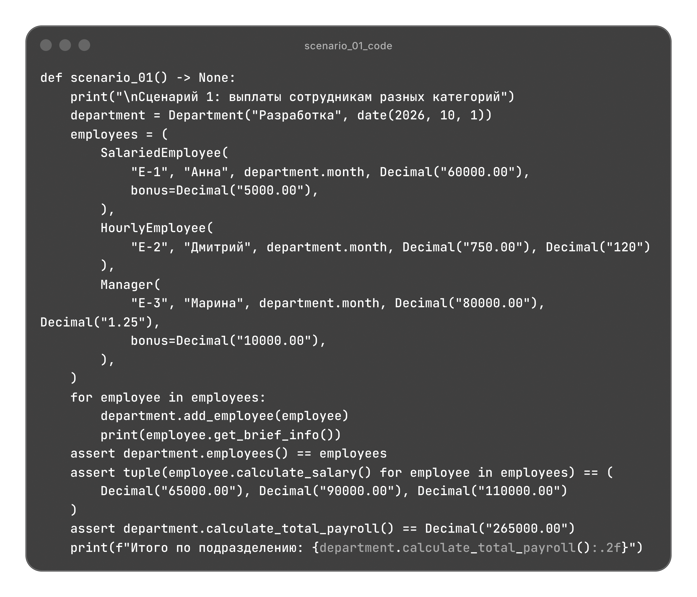
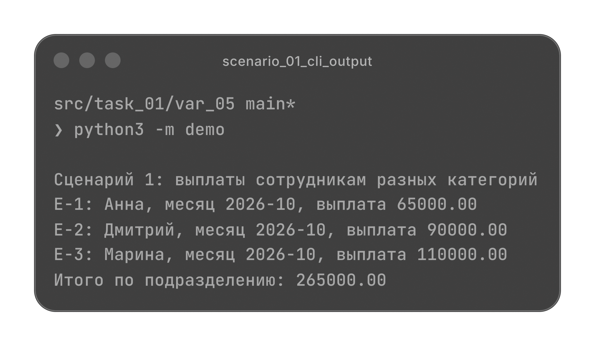
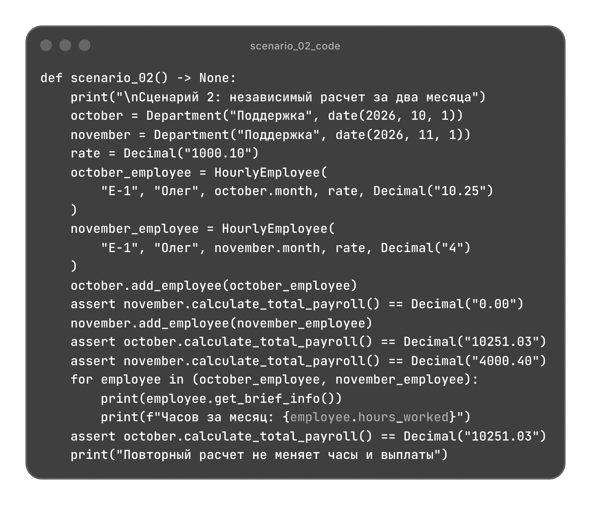
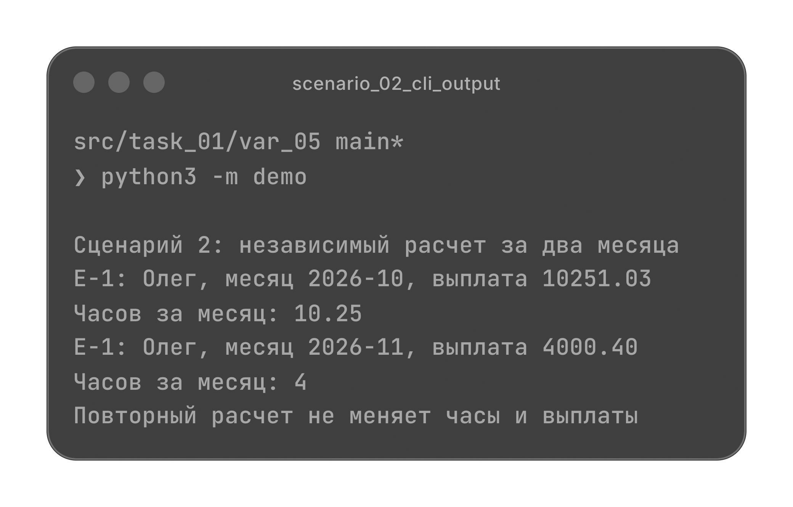
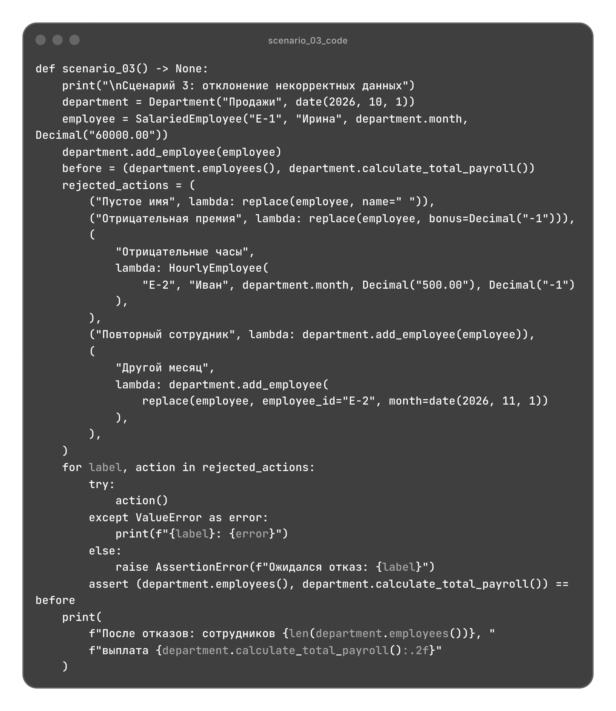
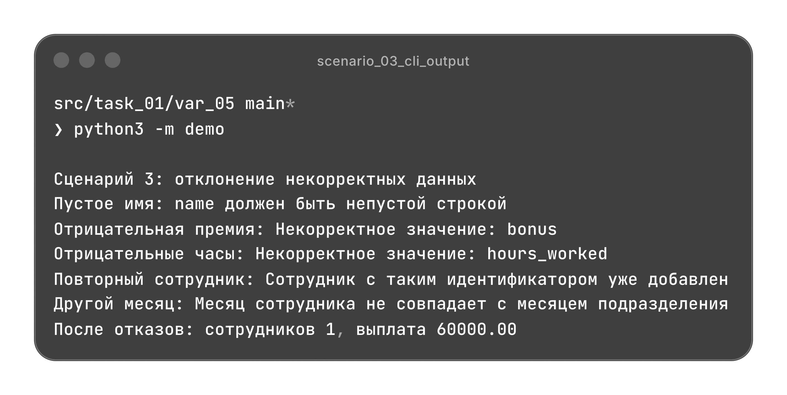

# Система сотрудников компании

Расчет месячных выплат штатным сотрудникам, почасовым специалистам и менеджерам, краткая информация о сотрудниках и общая сумма по подразделению.

[Архитектура](#архитектура) | [Сценарии](#сценарии)

## Архитектура

| Файл | Назначение |
| --- | --- |
| [models.py](./models.py) | Общие данные сотрудников, три категории и формулы выплат. |
| [validate.py](./validate.py) | Проверки строк, месяца, чисел, денежных сумм и добавления сотрудников. |
| [main.py](./main.py) | Состав подразделения и общая сумма месячных выплат. |
| [demo.py](./demo.py) | Три независимых сценария с проверкой результатов. |

### Модели

`Employee(ABC)` хранит идентификатор, имя, месяц и необязательную премию `bonus`. Общие данные и формирование краткой информации не повторяются в наследниках. Модели используют `dataclass` с `frozen=True` и `slots=True`.

| Класс | Данные для основной выплаты | Формула |
| --- | --- | --- |
| `SalariedEmployee` | Месячный оклад `monthly_salary`. | `monthly_salary` |
| `HourlyEmployee` | Ставка `hourly_rate` и часы за месяц `hours_worked`. | `hourly_rate * hours_worked` |
| `Manager` | Оклад `monthly_salary` и коэффициент эффективности `kpi_multiplier`. | `monthly_salary * kpi_multiplier` |

### Расчет выплат

Каждая категория реализует `_base_pay()`, объявленный через `@abstractmethod`. Общий `calculate_salary()` прибавляет премию к основной выплате и округляет результат до копеек через `ROUND_HALF_UP`. По умолчанию премия равна нулю; для выбранных сотрудников она задается через `bonus=`.

Это паттерн "Шаблонный метод": итог собирается в одном месте, наследники определяют только свою формулу. Новая категория добавляется без изменения расчета в подразделении.

`get_brief_info()` возвращает строку с идентификатором, именем, месяцем и выплатой. Он использует `calculate_salary()`, поэтому отдельного расчета для описания нет. Вывод в консоль находится в `demo.py`.

### Месячный период

`month` задается объектом `date` с первым числом нужного месяца. Часы, премия и коэффициент эффективности относятся только к этому месяцу.

Объект сотрудника содержит неизменяемые данные для одного месячного расчета. Для следующего месяца создается новый объект с новыми показателями. Часы не накапливаются, повторный расчет не меняет данные.

### Валидация

`validate.py` не зависит от моделей и подразделения. Он проверяет непустые имена и идентификаторы, формат месяца, совпадение месяцев и отсутствие повторного идентификатора в подразделении.

Числовые показатели передаются через конечные `Decimal`. Оклад и ставка должны быть положительными, премия, часы и коэффициент эффективности могут быть нулевыми. Отрицательные значения запрещены. Часы могут быть дробными; денежные суммы задаются с точностью до копеек.

Неверный тип сотрудника, числового показателя или месяца вызывает `TypeError`. Недопустимые значения, пустые строки, повторный идентификатор и несовпадение месяцев вызывают `ValueError`.

### Подразделение

`Department` использует `dataclass`. Название и месяц защищены от переназначения, сотрудники хранятся в закрытом словаре по идентификатору. Состав доступен снаружи как кортеж и меняется только через `add_employee()`.

Подразделение работает с общим типом `Employee` и вызывает `calculate_salary()` у каждого сотрудника. Расчет не проверяет названия профессий или конкретные категории. Суммируются уже округленные индивидуальные выплаты, для пустого подразделения результат равен `0.00`.

Перед добавлением выполняются все проверки. При отказе состав и сумма выплат сохраняются. Разные подразделения и месяцы хранят свои данные независимо.

Методы Department

| Метод | Результат |
| --- | --- |
| `add_employee(employee)` | Добавляет сотрудника с уникальным идентификатором за месяц подразделения. |
| `employees()` | Кортеж сотрудников в порядке добавления. |
| `calculate_total_payroll()` | Общая сумма месячных выплат типа `Decimal`. |

## Сценарии

`demo.py` содержит три независимых сценария. Каждый сценарий создает собственные объекты и проверяет результаты через `assert`.

Импорты demo.py

### Выплаты сотрудникам разных категорий

В подразделение "Разработка" за октябрь 2026 года добавляются штатный сотрудник, почасовой специалист и менеджер.

Оклад `60000.00` и премия `5000.00` дают `65000.00`. Ставка `750.00` за `120` часов дает `90000.00`. Оклад менеджера `80000.00`, коэффициент `1.25` и премия `10000.00` дают `110000.00`. Общая сумма равна `265000.00`.

Код scenario_01()

### Независимый расчет за два месяца

Один почасовой специалист представлен отдельными объектами за октябрь и ноябрь. При ставке `1000.10` за `10.25` часа октябрьская выплата округляется с `10251.025` до `10251.03`. За `4` часа ноября выплата составляет `4000.40`.

До добавления сотрудника сумма за ноябрь равна `0.00`. Добавление ноябрьских данных и повторный расчет не меняют октябрьскую выплату.

Код scenario_02()

### Отклонение некорректных данных

Пустое имя, отрицательная премия и отрицательные часы отклоняются при создании сотрудника. Подразделение отклоняет повторное добавление сотрудника и данные за другой месяц.

После каждого отказа проверяется сохранность состава и выплаты. В подразделении остается один сотрудник с выплатой `60000.00`.

Код scenario_03()

