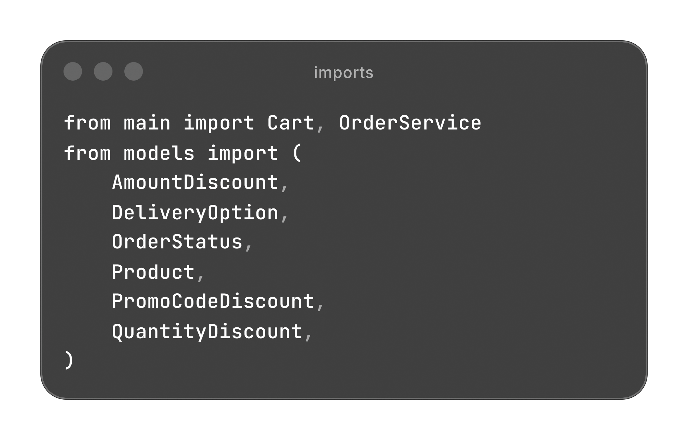
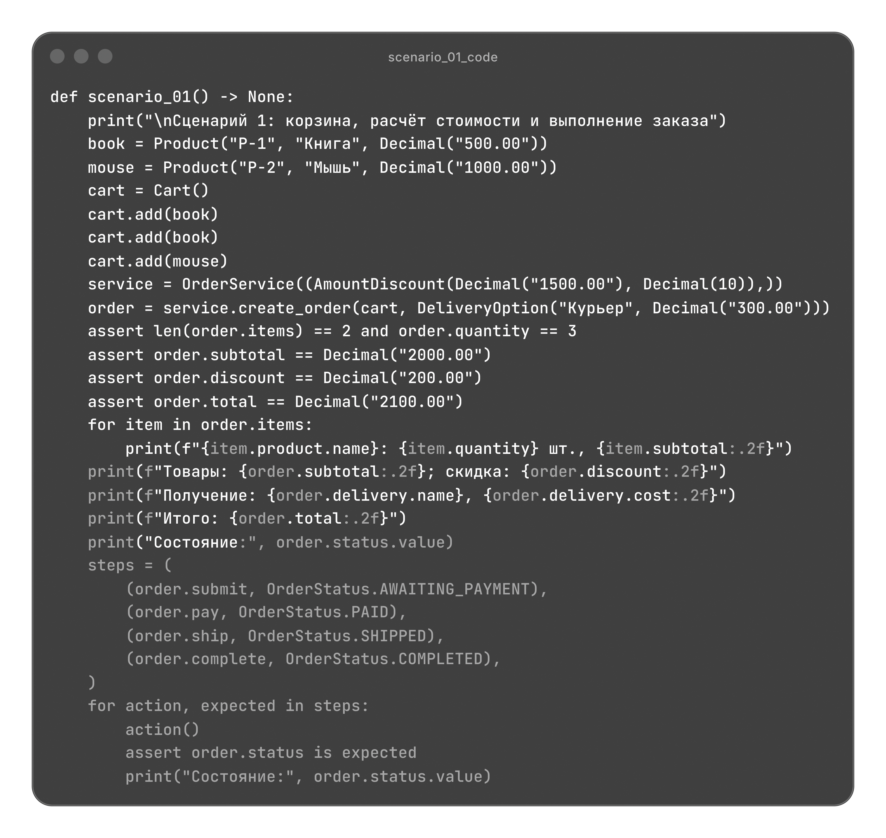
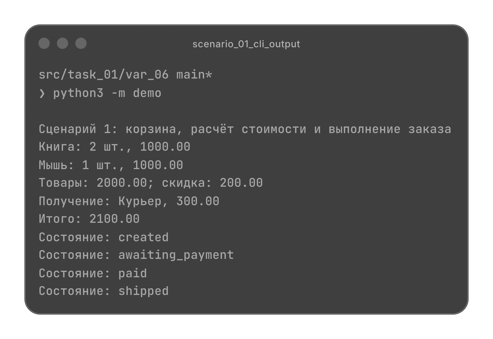
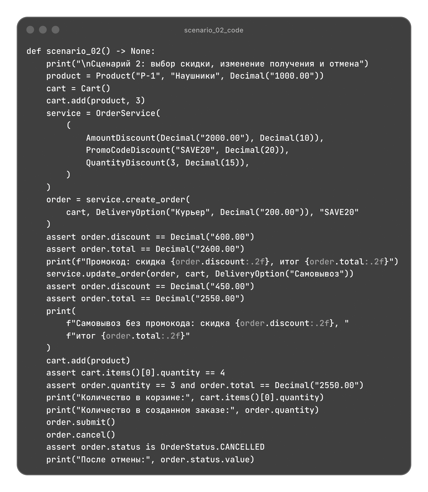
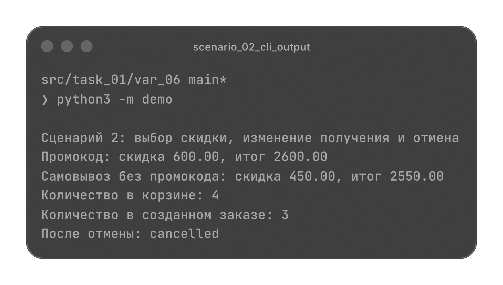
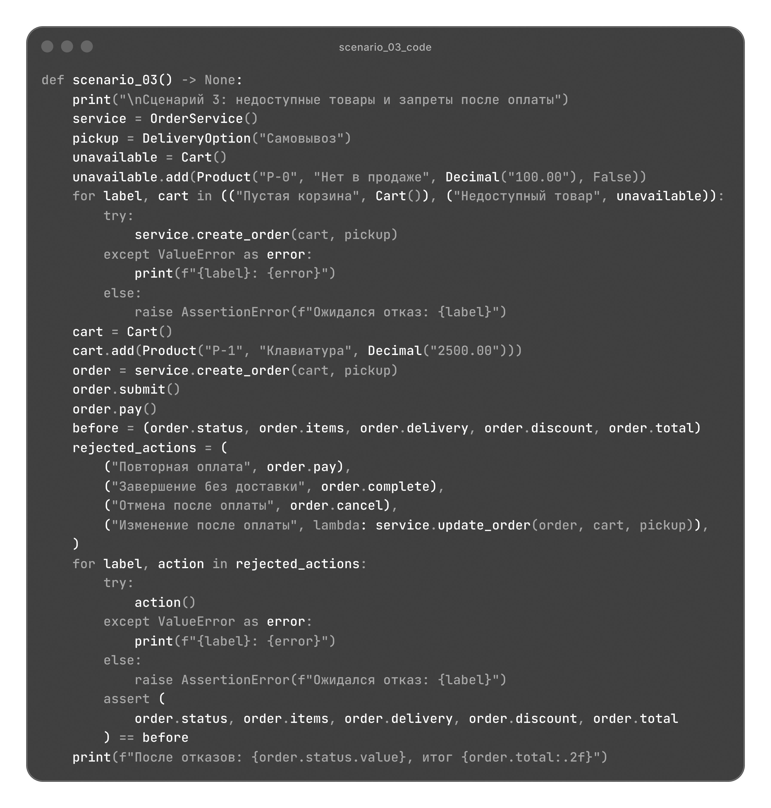
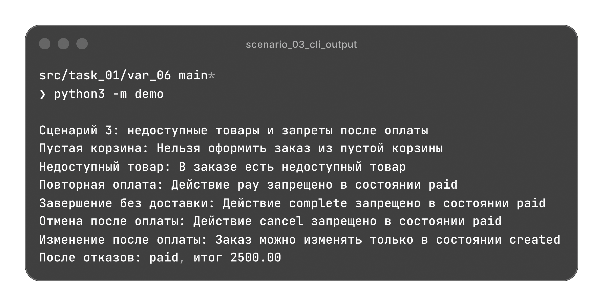

# Оформление заказа в интернет-магазине

Корзина, выбор способа получения, расчет скидки и прохождение заказа от создания до выполнения или отмены.

[Архитектура](#архитектура) | [Сценарии](#сценарии)

## Архитектура

| Файл | Назначение |
| --- | --- |
| [models.py](./models.py) | Товары, позиции и данные заказа; правила скидок и состояния заказа. |
| [validate.py](./validate.py) | Проверки входных данных, денежных сумм и ограничений заказа. |
| [main.py](./main.py) | Корзина, оформление и изменение заказа, расчет скидки. |
| [demo.py](./demo.py) | Три независимых сценария с проверкой результатов. |

### Модели

`Product`, `OrderItem` и `DeliveryOption` используют `dataclass` с `frozen=True` и `slots=True`. Денежные значения передаются через `Decimal` с точностью до копеек.

| Класс | Данные |
| --- | --- |
| `Product` | Идентификатор, название, положительная цена и признак доступности товара. |
| `OrderItem` | Товар и положительное целое количество; `subtotal` вычисляет стоимость позиции. |
| `DeliveryOption` | Способ получения и его стоимость; ноль подходит для самовывоза. |
| `Order` | Кортеж позиций, получение, промокод, скидка и текущее состояние заказа. |

`Order` также описан через `dataclass`. Его поля защищены от прямого присваивания, а предусмотренные изменения выполняются методами модели и сервиса. Итог вычисляется как `subtotal - discount + delivery.cost`.

### Правила скидок

`DiscountRule(ABC)` объявляет метод `calculate(subtotal, quantity, promo_code)` через `@abstractmethod`. Каждое правило возвращает сумму скидки типа `Decimal` от нуля до стоимости товаров.

| Правило | Условие применения |
| --- | --- |
| `AmountDiscount` | Сумма товаров достигла заданного порога. |
| `PromoCodeDiscount` | Промокод совпал с заданным, включая регистр. |
| `QuantityDiscount` | Общее количество единиц достигло заданного порога. |

Правила подключаются к `OrderService` через `discount_rules`. Это паттерн "Стратегия": новое правило расширяет расчет без изменения заказа и сервиса.

Из подходящих скидок выбирается максимальная. Скидки не складываются и относятся только к товарам. Доставка оплачивается отдельно, итоговая скидка округляется до копеек через `ROUND_HALF_UP`.

### Состояния заказа

`OrderState(ABC)` задает абстрактный метод `transitions()`. Каждый класс состояния определяет допустимые переходы, а общий `next_state()` проверяет действие. Это паттерн "Состояние".

| Состояние | Допустимые действия |
| --- | --- |
| `created` | `submit()` отправляет на оплату; `cancel()` отменяет заказ. |
| `awaiting_payment` | `pay()` оплачивает заказ; `cancel()` отменяет его. |
| `paid` | `ship()` передает заказ в доставку. |
| `shipped` | `complete()` завершает заказ. |
| `completed` | Дальнейших переходов нет. |
| `cancelled` | Дальнейших переходов нет. |

Изменять состав, способ получения и промокод можно только в состоянии `created`. После отправки на оплату данные фиксируются. Недопустимое действие сохраняет прежнее состояние.

### Валидация

`validate.py` не зависит от моделей и сервиса. Он проверяет типы, непустые строки, положительные количества, доступность товаров, состав заказа и допустимость изменений. `bool` не принимается как количество.

Денежные значения должны быть конечными `Decimal` с допустимым знаком и точностью. Процент ограничен диапазоном `0 < percent <= 100`, сумма скидки не может превышать стоимость товаров.

Нарушения условий вызывают `ValueError`, неверный тип модели или денежного значения вызывает `TypeError`.

### Корзина и оформление

`Cart` и `OrderService` используют `dataclass`. Корзина объединяет одинаковые товары по идентификатору и возвращает позиции кортежем. Разные данные товара с одним идентификатором отклоняются.

При оформлении заказ получает независимый снимок корзины. Последующие изменения корзины не меняют заказ. При обновлении сервис сначала проверяет и рассчитывает новые данные, затем заменяет прежние; ошибка сохраняет состав, стоимость и состояние заказа.

Методы Cart и OrderService

| Метод | Результат |
| --- | --- |
| `Cart.add(product, quantity=1)` | Добавляет товар или увеличивает количество существующей позиции. |
| `Cart.remove(product_id)` | Удаляет всю позицию; неизвестный идентификатор вызывает ошибку. |
| `Cart.items()` | Кортеж текущих позиций. |
| `OrderService.create_order(...)` | Новый заказ с проверенными данными и рассчитанной скидкой. |
| `OrderService.update_order(...)` | Обновляет созданный заказ после успешных проверок. |

## Сценарии

`demo.py` содержит три независимых сценария. Каждый сценарий создает собственные объекты и проверяет результаты через `assert`.

Импорты demo.py

### Оформление и выполнение заказа

В корзину дважды добавляется книга по `500.00` и один раз мышь за `1000.00`. Получаются две позиции и три единицы товара.

Сумма товаров равна `2000.00`, скидка составляет `200.00`, доставка стоит `300.00`. Итог `2100.00`. Заказ проходит оплату и доставку, затем завершается в состоянии `completed`.

Код scenario_01()

### Выбор скидки и отмена заказа

Для трех наушников по `1000.00` подходят скидки по сумме `10%`, промокоду `SAVE20` `20%` и количеству `15%`. Выбирается скидка `600.00`; с доставкой за `200.00` итог равен `2600.00`.

При замене доставки самовывозом и удалении промокода скидка становится `450.00`, итог `2550.00`. Добавление четвертой единицы в корзину не меняет заказ. После отправки на оплату заказ отменяется.

Код scenario_02()

### Отказы без изменения заказа

Оформление пустой корзины и заказа с недоступным товаром отклоняется. Для оплаченной клавиатуры за `2500.00` запрещены повторная оплата, завершение без доставки, отмена и изменение данных.

После каждого отказа проверяется сохранность заказа. Итог остается `2500.00`, состояние сохраняется как `paid`.

Код scenario_03()

