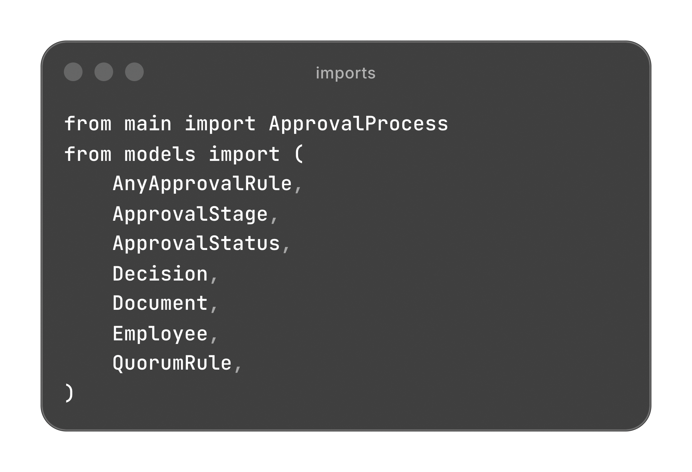
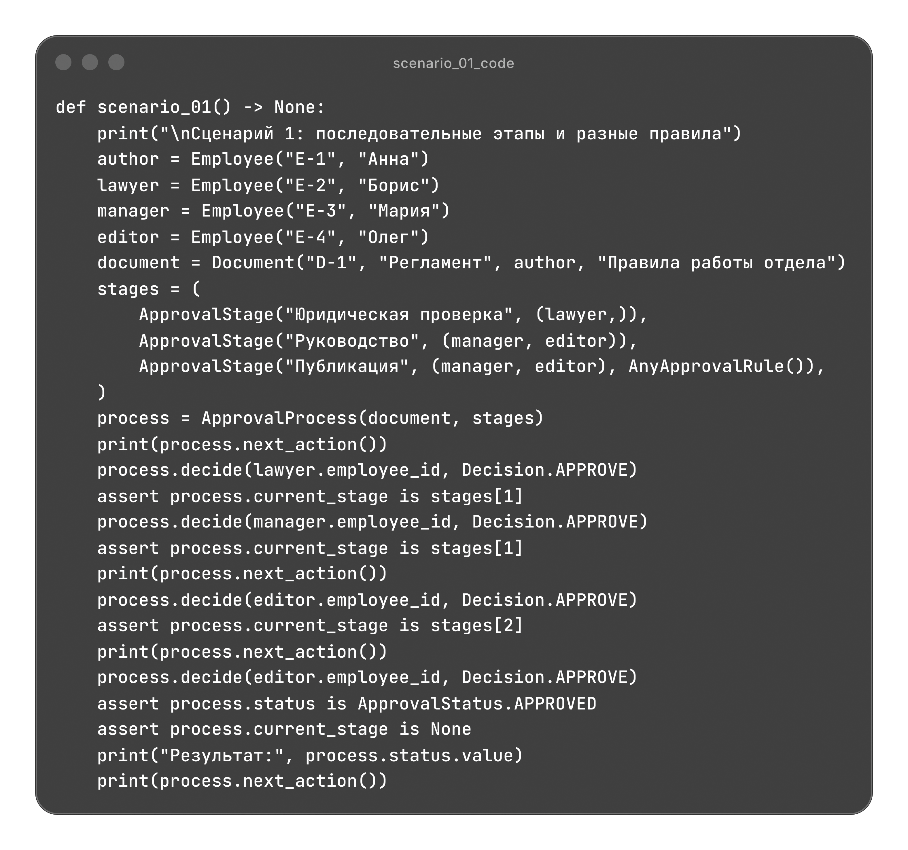
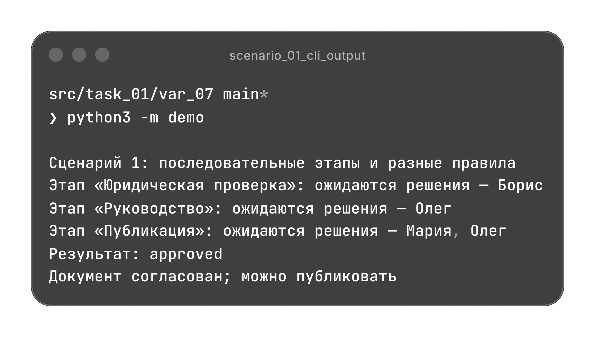
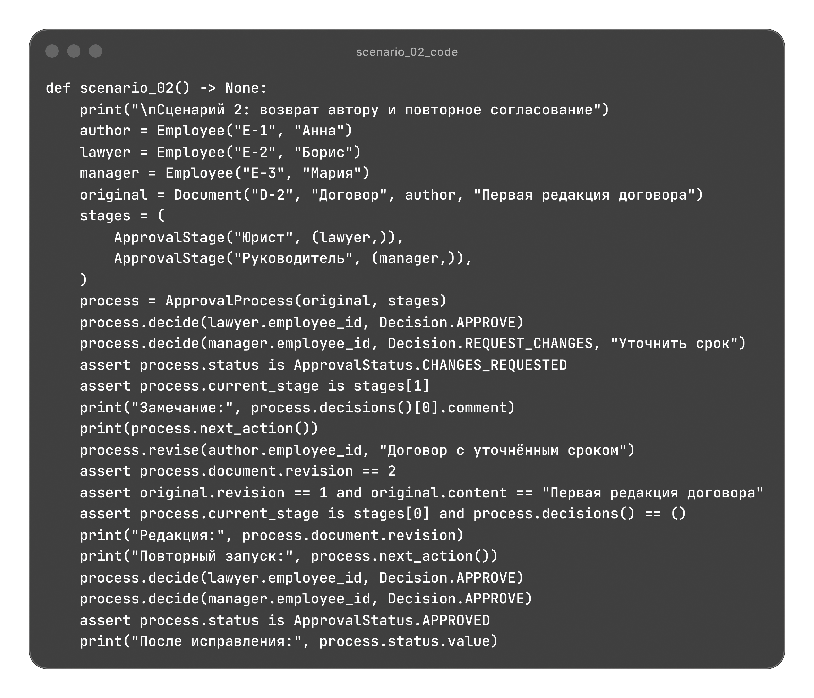
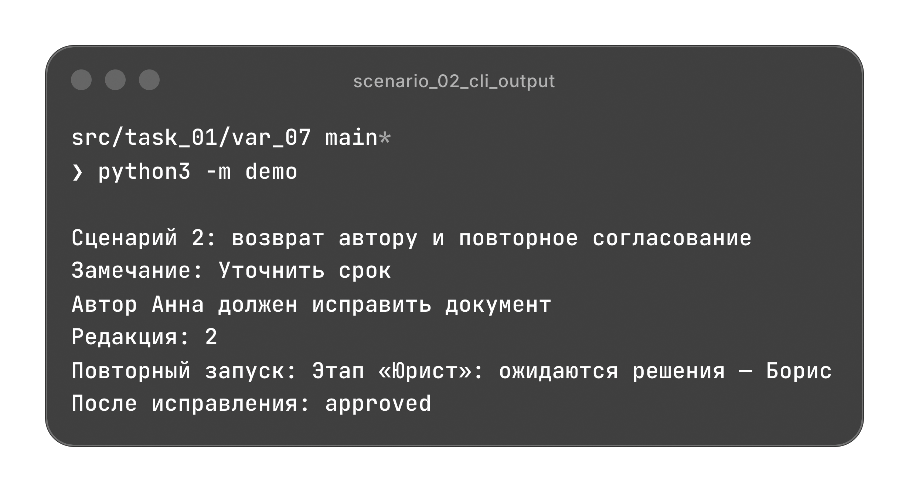
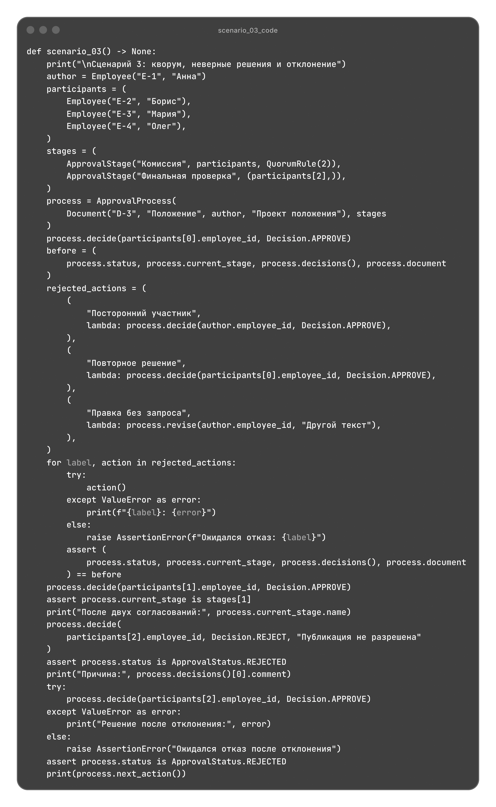
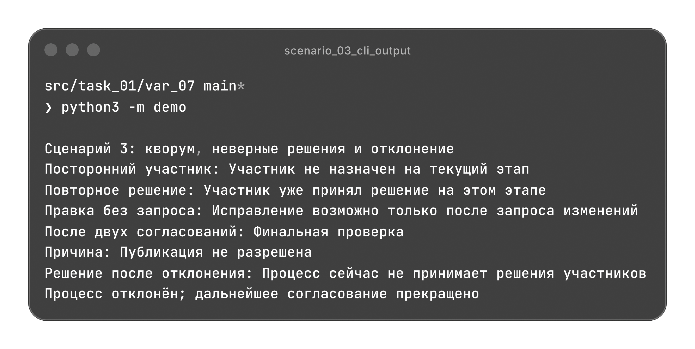

# Согласование документов

Последовательные этапы согласования с назначенными участниками, разными правилами завершения и возвратом документа автору.

[Архитектура](#архитектура) | [Сценарии](#сценарии)

## Архитектура

| Файл | Назначение |
| --- | --- |
| [models.py](./models.py) | Сотрудник, документ, решение, этап и правила его завершения. |
| [validate.py](./validate.py) | Проверки полей, участников, порога согласований и допустимости действий. |
| [main.py](./main.py) | Последовательность этапов, обработка решений, исправление и следующее действие. |
| [demo.py](./demo.py) | Три независимых сценария с проверкой результатов. |

### Модели

Модели используют `dataclass` с `frozen=True` и `slots=True`. Их поля проверяются при создании, участники этапов сохраняются кортежами.

| Класс | Данные |
| --- | --- |
| `Employee` | Идентификатор и имя сотрудника. |
| `Document` | Идентификатор, название, автор, содержание и номер редакции. |
| `DecisionRecord` | Участник, его решение и необязательный комментарий. |
| `ApprovalStage` | Название этапа, назначенные участники и правило завершения. |

`Document` содержит данные документа. Состояние согласования и переходы между этапами находятся в `ApprovalProcess`. Начальный номер редакции равен `1`.

### Правила согласования

`CompletionRule(ABC)` объявляет метод `required_approvals(participant_count)` через `@abstractmethod`. Общий `evaluate()` обрабатывает решения и возвращает `ApprovalStatus`.

| Правило | Необходимое число согласований |
| --- | --- |
| `AllApprovalsRule` | Все назначенные участники; используется по умолчанию. |
| `AnyApprovalRule` | Один назначенный участник. |
| `QuorumRule(minimum_approvals)` | Заданный положительный порог, не превышающий число участников. |

Решение `approve` учитывается в числе согласований. Полученное `reject` прекращает процесс, а `request_changes` приостанавливает его до исправления автором.

Результат вычисляется после каждого ответа. Завершенный этап больше не принимает решения; для `AnyApprovalRule` первый ответ определяет результат этапа.

Новое правило подключается к этапу без изменения документа и процесса. Это паттерн "Стратегия". Общий `evaluate()` вызывает `required_approvals()` подкласса и переиспользует обработку решений, реализуя шаблонный метод.

### Валидация

`validate.py` не зависит от моделей и процесса. Он проверяет строки, типы, участников, порог согласований, наличие этапов и допустимость действий.

В одном этапе идентификаторы участников уникальны, каждый сотрудник может принять одно решение. Один сотрудник может участвовать в нескольких этапах. Исправление разрешено только автору после запроса изменений.

Нарушения условий вызывают `ValueError`, неверный тип модели, решения или комментария вызывает `TypeError`.

### Процесс согласования

`ApprovalProcess` описан через `dataclass` и хранит текущую редакцию, кортеж этапов и решения текущего этапа. Он начинает работу в `in_progress`, после последнего успешного этапа получает статус `approved`, после отклонения получает `rejected`.

При `changes_requested` автор может исправить содержание. Создается новая редакция документа, номер увеличивается, решения сбрасываются и согласование начинается с первого этапа. Исходный объект документа сохраняется.

Ошибки проверок или правила не меняют документ, решения и состояние процесса. `current_stage` возвращает текущий этап, а после согласования или отклонения возвращает `None`. `decisions()` возвращает только решения текущего или последнего завершившего процесс этапа.

Методы ApprovalProcess

| Метод | Результат |
| --- | --- |
| `decide(...)` | Принимает решение назначенного участника и применяет правило этапа. |
| `decisions()` | Кортеж неизменяемых записей решений. |
| `revise(author_id, content)` | Создает новую редакцию и начинает согласование заново. |
| `next_action()` | Описание следующего действия, ожидаемых участников или результата процесса. |

## Сценарии

`demo.py` содержит три независимых сценария. Каждый сценарий создает собственные объекты и проверяет результаты через `assert`.

Импорты demo.py

### Последовательное согласование

Регламент проходит юридическую проверку у Бориса, согласование руководства у Марии и Олега, затем этап публикации, где достаточно одного согласования.

На втором этапе после ответа Марии процесс ожидает Олега. На третьем его согласование сразу завершает процесс: статус `approved`, текущего этапа больше нет, документ можно публиковать.

Код scenario_01()

### Возврат на исправление

Юрист согласует договор, руководитель возвращает его с замечанием "Уточнить срок". Процесс переходит в `changes_requested` и ожидает автора.

Автор исправляет содержание: создается редакция `2`, исходная редакция `1` сохраняется. Повторное согласование начинается с юридического этапа; после двух согласований результат становится `approved`.

Код scenario_02()

### Кворум и отклонение документа

Комиссии достаточно двух согласований из трех. После первого голоса отклоняются решение постороннего участника, повторный голос и исправление без запроса. Данные процесса сохраняются.

Второе согласование переводит процесс на финальную проверку. Олег отклоняет документ с причиной "Публикация не разрешена"; последующее решение запрещается. Итоговый статус `rejected`.

Код scenario_03()

