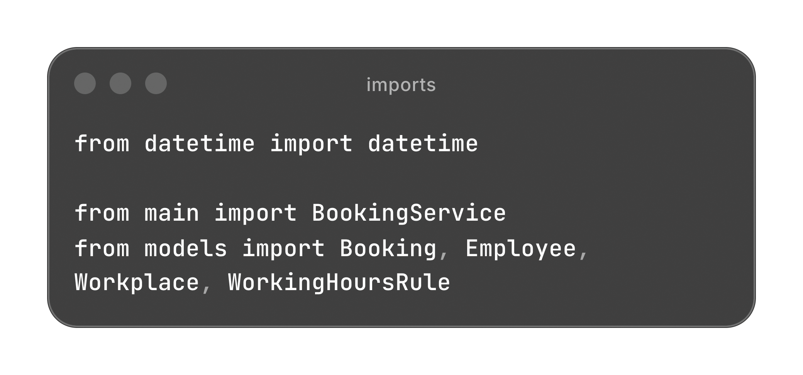
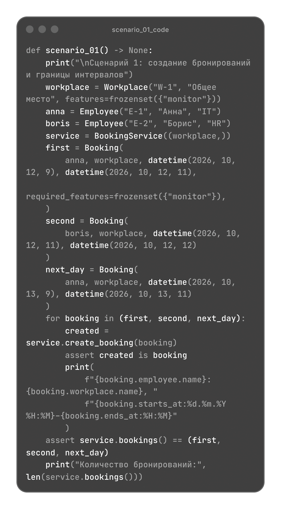
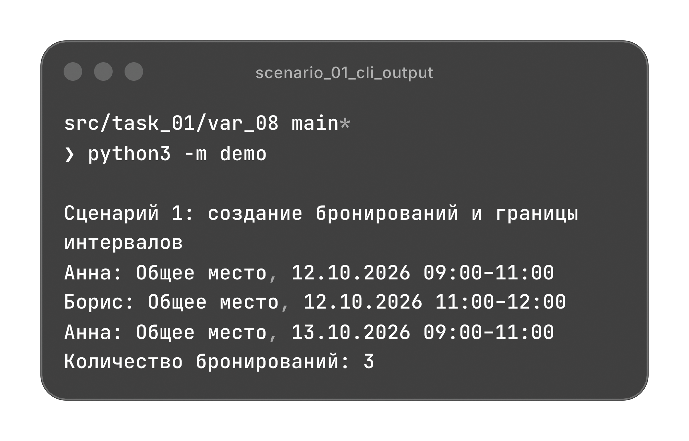
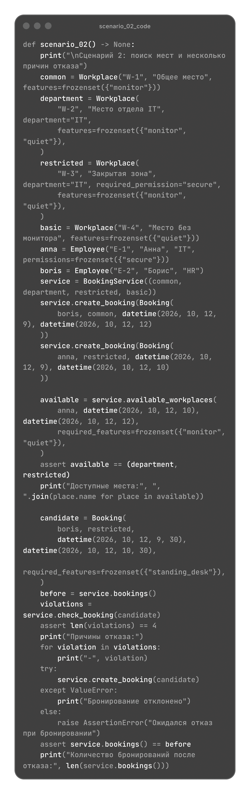
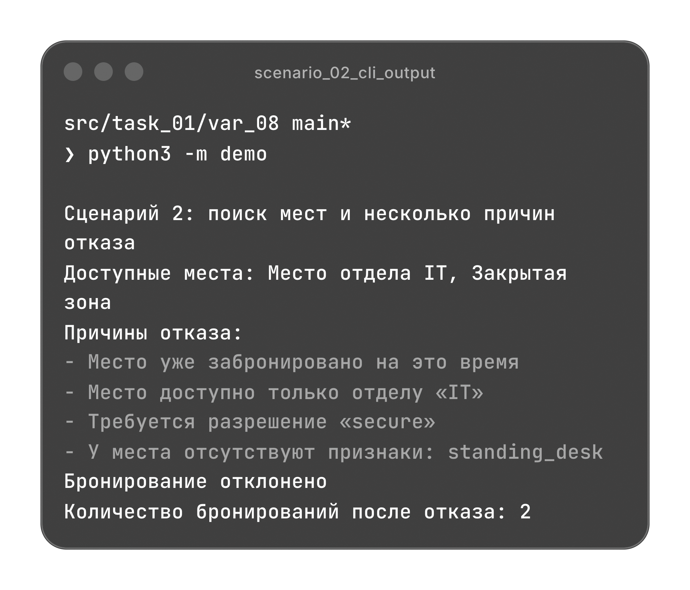
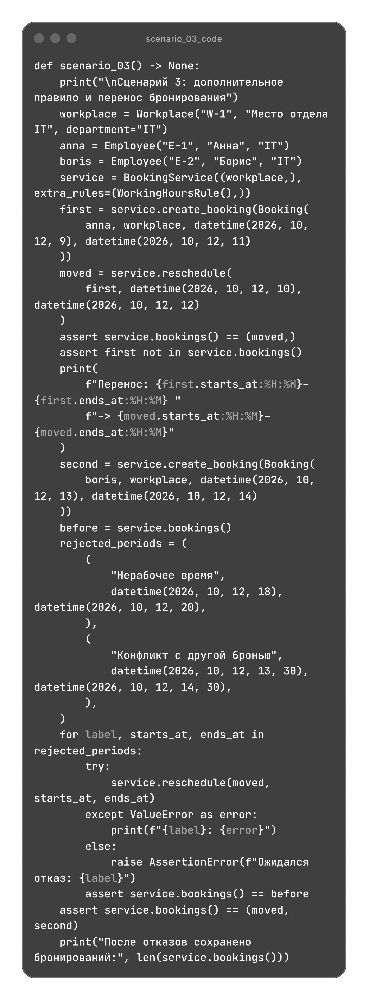
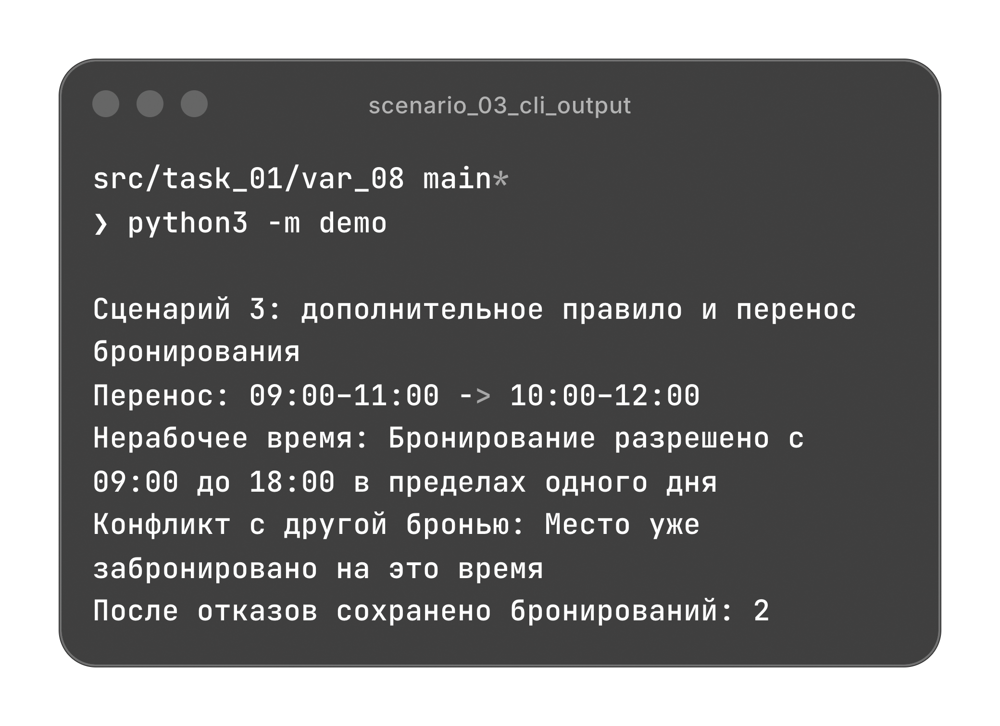

# Бронирование рабочих мест

Создание, поиск и перенос бронирований с учетом доступа, оснащения и занятости мест.

[Архитектура](#архитектура) | [Сценарии](#сценарии)

## Архитектура

| Файл | Назначение |
| --- | --- |
| [models.py](./models.py) | Неизменяемые модели сотрудников, мест и бронирований; правила доступа и занятости. |
| [validate.py](./validate.py) | Проверки входных данных, времени, регистрации и допустимости изменений. |
| [main.py](./main.py) | Каталог мест, хранение бронирований, создание, поиск и перенос брони. |
| [demo.py](./demo.py) | Три независимых сценария с проверкой результатов. |

### Модели

Модели используют `dataclass` с `frozen=True` и `slots=True`. Их поля проверяются при создании, наборы разрешений и признаков сохраняются как `frozenset`.

| Класс | Данные |
| --- | --- |
| `Employee` | Идентификатор, имя, отдел и разрешения сотрудника. |
| `Workplace` | Идентификатор, название, ограничения по отделу и разрешению, признаки места. |
| `Booking` | Сотрудник, место, начало и окончание брони, необходимые признаки `required_features`. |

`None` в полях `department` и `required_permission` у места означает отсутствие соответствующего ограничения.

Создание объекта `Booking` проверяет его поля. Регистрация брони происходит отдельно через `BookingService.create_booking()` после проверки правил.

### Правила бронирования

`BookingRule(ABC)` объявляет метод `check(booking, existing_bookings)` через `@abstractmethod`. Каждое правило возвращает текст нарушения или `None`. По умолчанию действуют четыре правила:

| Правило | Условие |
| --- | --- |
| `NoOverlapRule` | Интервал не пересекается с другой бронью того же места. |
| `DepartmentRule` | Отдел сотрудника соответствует ограничению места. |
| `PermissionRule` | У сотрудника есть требуемое разрешение. |
| `FeaturesRule` | Место имеет все признаки из `required_features`. |

При проверке пересечений интервал `[starts_at, ends_at)` не включает момент окончания, поэтому соседние брони допустимы. Сравниваются полные даты и время.

Дополнительные правила подключаются через `extra_rules` без изменения алгоритма сервиса. Это паттерн "Стратегия" и применение OCP. Например, `WorkingHoursRule` разрешает бронирование с `09:00` до `18:00` в пределах одного дня.

### Валидация

`validate.py` не зависит от моделей и сервиса. Он проверяет типы, строки, наборы строк, уникальность идентификаторов мест и регистрацию объектов.

Для интервалов используется местное время офиса без часового пояса. Начало должно быть раньше окончания.

`validate_type()` использует `TypeError`. Недопустимые значения, отсутствие регистрации и нарушения правил приводят к `ValueError`. При отказе создания или переноса сообщения правил объединяются в одно исключение.

### Сервис

`BookingService` описан через `dataclass` и хранит бронирования в памяти. Каталог и конфигурация правил сохраняются в кортежах. Создание, поиск и перенос используют общий механизм проверки правил, что исключает дублирование условий.

Для создания нужен экземпляр места из каталога сервиса. Для переноса передается зарегистрированная бронь: сервис проверяет новый интервал без учета ее старой версии и возвращает новый объект. Дальнейшие действия выполняются с этим объектом.

При отказе создания или переноса действующие бронирования сохраняются. Поиск и проверка не изменяют данные.

Методы BookingService

| Метод | Результат |
| --- | --- |
| `bookings()` | Кортеж текущих бронирований. |
| `check_booking(booking)` | Все нарушения правил или пустой кортеж. Некорректные данные вызывают исключение. |
| `create_booking(booking)` | Зарегистрированная бронь после успешной проверки. |
| `available_workplaces(...)` | Подходящие по времени, доступу и признакам места в порядке каталога. |
| `reschedule(...)` | Новая версия брони, заменяющая прежнюю после успешной проверки. |

## Сценарии

`demo.py` содержит три независимых сценария. Каждый сценарий создает собственные объекты и проверяет результаты через `assert`.

Импорты demo.py

### Создание бронирований

Анна бронирует общее место на `12.10.2026` с `09:00` до `11:00`, а Борис занимает его с `11:00` до `12:00` того же дня. Еще одна бронь Анны создана на следующий день. Все три бронирования разрешены.

Код scenario_01()

### Поиск и причины отказа

Анна ищет места с признаками `monitor` и `quiet` и получает два результата: "Место отдела IT" и "Закрытая зона".

Попытка Бориса забронировать закрытую зону отклоняется по четырем причинам: пересечение времени, ограничение по отделу, отсутствие разрешения и признака `standing_desk`. Две исходные брони сохраняются.

Код scenario_02()

### Перенос и дополнительное правило

Бронь Анны с `09:00` до `11:00` переносится на время с `10:00` до `12:00`. Пересечение с ее исходным интервалом не мешает переносу.

При подключенном `WorkingHoursRule` отклоняются переносы на время с `18:00` до `20:00` и с `13:30` до `14:30`: первый выходит за рабочие часы, второй пересекается с бронью Бориса. После обоих отказов сохраняются две действующие брони.

Код scenario_03()

