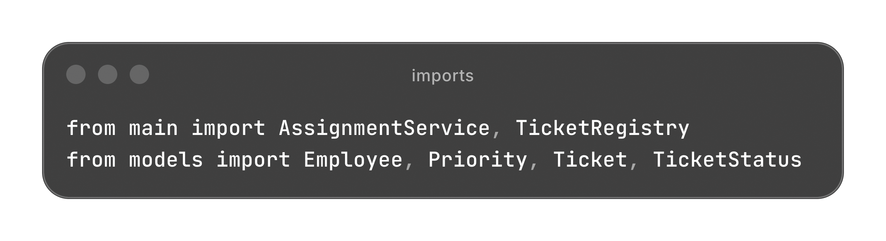
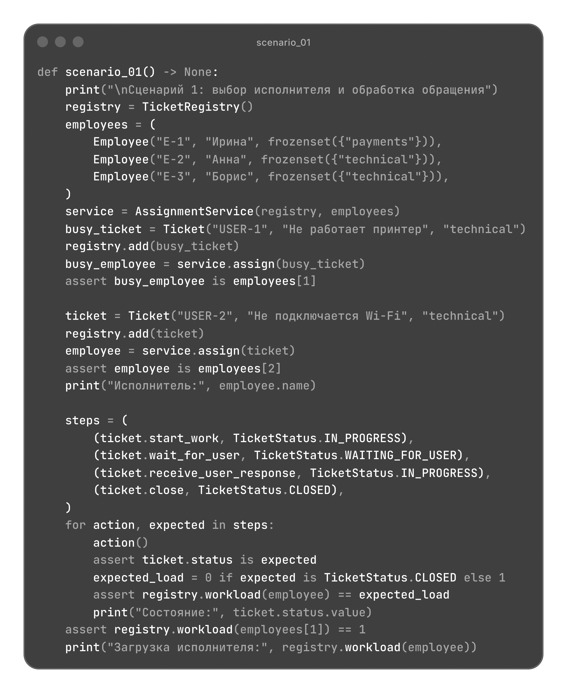
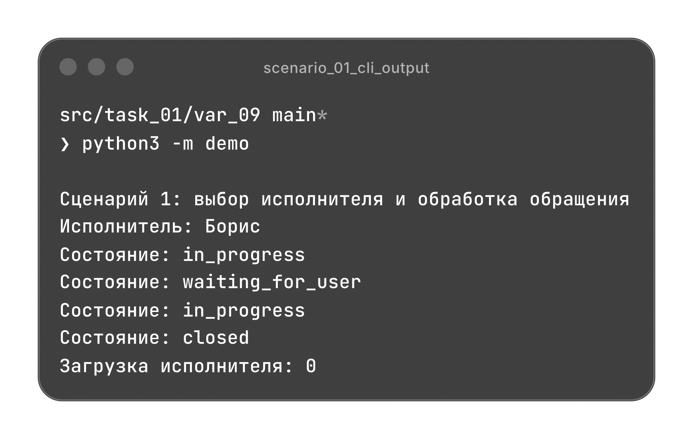
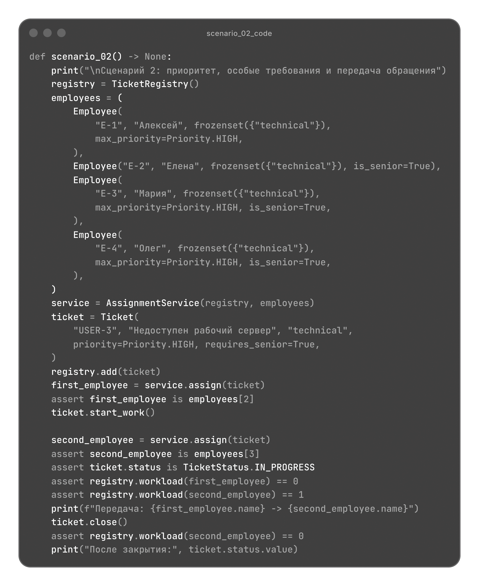
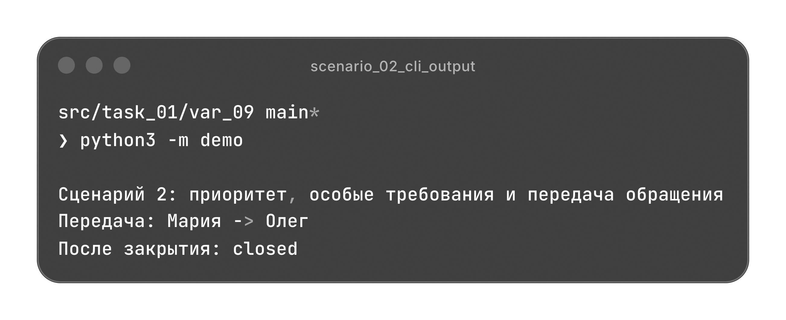
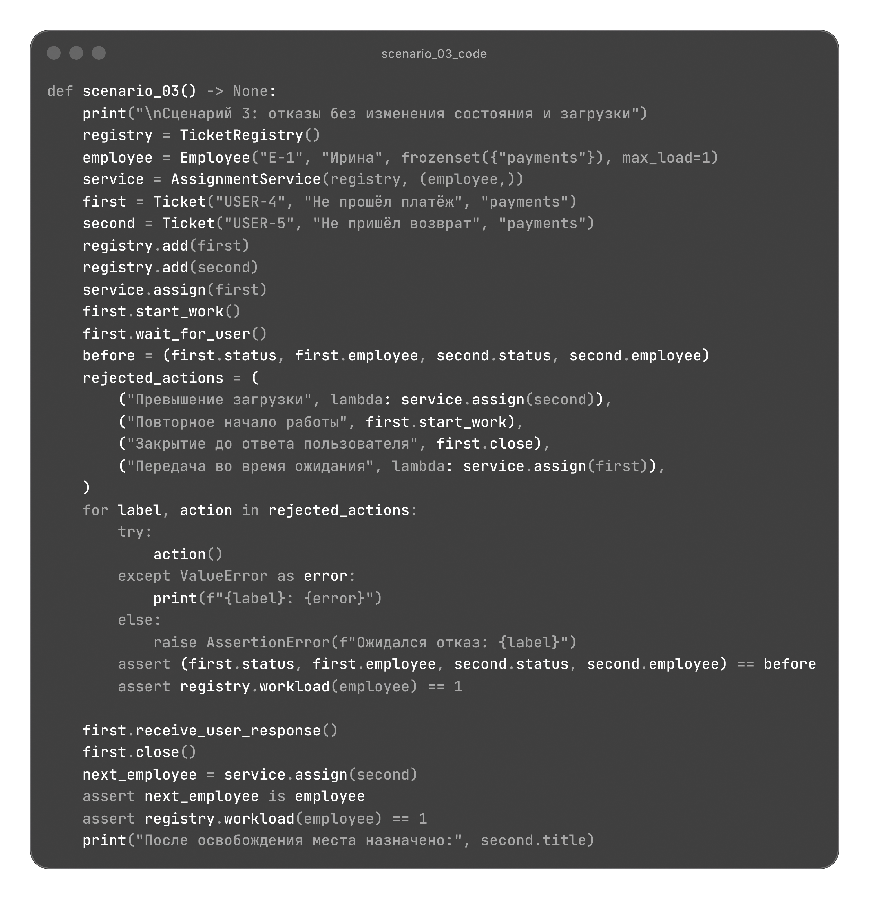
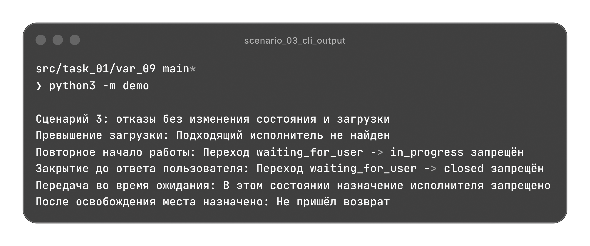

# Служба поддержки

Регистрация обращений, автоматический выбор исполнителя, передача между сотрудниками и изменение состояния с учетом текущей загрузки.

[Архитектура](#архитектура) | [Сценарии](#сценарии)

## Архитектура

| Файл | Назначение |
| --- | --- |
| [models.py](./models.py) | Сотрудники, обращения, переходы состояний и правила выбора исполнителя. |
| [validate.py](./validate.py) | Проверки входных данных, регистрации и допустимости действий. |
| [main.py](./main.py) | Реестр обращений, вычисление загрузки и назначение исполнителей. |
| [demo.py](./demo.py) | Три независимых сценария с проверкой результатов. |

### Модели

Модели используют `dataclass` с `frozen=True` и `slots=True`. Данные сотрудника неизменяемы, специализации сохраняются как `frozenset`. Исполнитель и состояние обращения меняются предусмотренными методами после проверок.

| Класс | Данные |
| --- | --- |
| `Employee` | Идентификатор, имя, специализации, предел загрузки, допустимый приоритет и признак старшего специалиста. |
| `Ticket` | Пользователь, тема, специализация, приоритет, требование старшего специалиста, исполнитель и состояние. |

Идентификатор обращения создается автоматически как `UUID`. Новое обращение находится в состоянии `NEW` и не имеет исполнителя. `Priority` содержит уровни `LOW`, `NORMAL` и `HIGH`.

### Состояния обращения

| Метод | Исходное состояние | Новое состояние |
| --- | --- | --- |
| `start_work()` | `NEW` | `IN_PROGRESS` |
| `wait_for_user()` | `IN_PROGRESS` | `WAITING_FOR_USER` |
| `receive_user_response()` | `WAITING_FOR_USER` | `IN_PROGRESS` |
| `close()` | `IN_PROGRESS` | `CLOSED` |

Каждый переход требует назначенного исполнителя. Назначать или передавать обращение можно в состояниях `NEW` и `IN_PROGRESS`. После закрытия ссылка на сотрудника сохраняется, но обращение освобождает место в его загрузке.

### Правила назначения

`AssignmentRule(ABC)` объявляет метод `allows(ticket, employee, current_load)` через `@abstractmethod`. Правило возвращает `bool`. Сотрудник должен пройти четыре обязательные проверки:

| Правило | Условие допуска |
| --- | --- |
| `SpecializationRule` | Специализация обращения входит в специализации сотрудника. |
| `WorkloadRule` | Текущая загрузка меньше `max_load`. |
| `PriorityRule` | Приоритет обращения не превышает `max_priority`. |
| `SeniorRule` | При требовании `requires_senior` сотрудник является старшим специалистом. |

Новые критерии подключаются через `extra_rules` вместе с обязательными. Это паттерн "Стратегия" и расширение алгоритма через общий интерфейс без изменения сервиса.

### Валидация

`validate.py` не зависит от моделей и сервиса. Он проверяет строки, типы, специализации, лимиты, уникальность идентификаторов сотрудников и условия назначения.

В реестр можно добавить только новое обращение без исполнителя. Повторная регистрация запрещена. Назначение требует регистрации, допустимого состояния и смены текущего исполнителя при передаче.

`validate_type()` использует `TypeError`. Нарушения значений и условий действий вызывают `ValueError`.

### Назначение и учет загрузки

`TicketRegistry` и `AssignmentService` описаны через `dataclass`. Реестр хранит обращения и вычисляет загрузку по назначенным незакрытым обращениям. Ожидание ответа пользователя также занимает место в лимите.

Сервис выбирает подходящего сотрудника с наименьшей загрузкой. При равенстве сохраняется порядок `employees`, текущий исполнитель исключается по идентификатору. Сотрудники и правила хранятся в кортежах.

Поиск не меняет данные. При отсутствии кандидата назначение вызывает ошибку, сохраняя исполнителя, состояние и загрузку. После закрытия обращения освобожденное место учитывается при следующем выборе автоматически.

Методы TicketRegistry и AssignmentService

| Метод | Результат |
| --- | --- |
| `TicketRegistry.add(ticket)` | Регистрирует новое обращение без исполнителя. |
| `TicketRegistry.contains(ticket)` | Проверяет наличие именно этого объекта в реестре. |
| `TicketRegistry.workload(employee)` | Число активных обращений сотрудника. |
| `AssignmentService.find_employee(ticket)` | Подходящий сотрудник или `None`. |
| `AssignmentService.assign(ticket)` | Назначает или меняет исполнителя и возвращает выбранного сотрудника. |

## Сценарии

`demo.py` содержит три независимых сценария. Каждый сценарий создает собственные объекты и проверяет результаты через `assert`.

Импорты demo.py

### Выбор исполнителя и обработка

Анна уже занята техническим обращением, поэтому новое обращение получает Борис. Он начинает работу, запрашивает ответ пользователя, возобновляет обработку и закрывает обращение.

После закрытия загрузка Бориса равна `0`, загрузка Анны остается `1`.

Код scenario_01()

### Высокий приоритет и передача

Обращение высокого приоритета требует старшего специалиста. Подходят Мария и Олег; сначала выбирается Мария, затем работающее обращение передается Олегу.

Загрузка Марии меняется с `1` на `0`, загрузка Олега с `0` на `1`. Закрытие обращения освобождает Олега.

Код scenario_02()

### Ограничения и сохранность данных

У Ирины лимит в одно обращение, которое ожидает ответа пользователя. Отклоняются назначение второго обращения, повторное начало работы, закрытие до ответа и передача во время ожидания.

Отказы не меняют состояние и загрузку. После ответа пользователя и закрытия первого обращения второе успешно назначается Ирине.

Код scenario_03()

