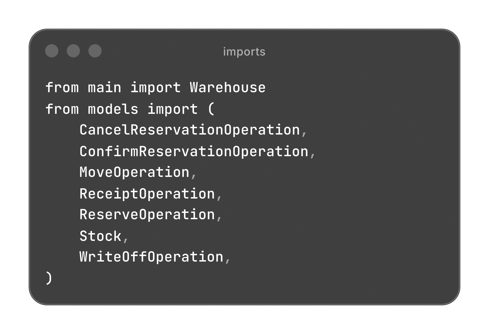
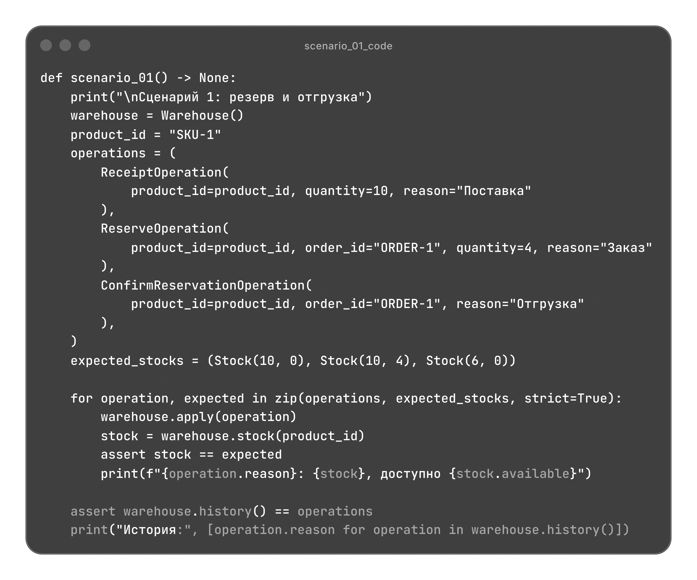
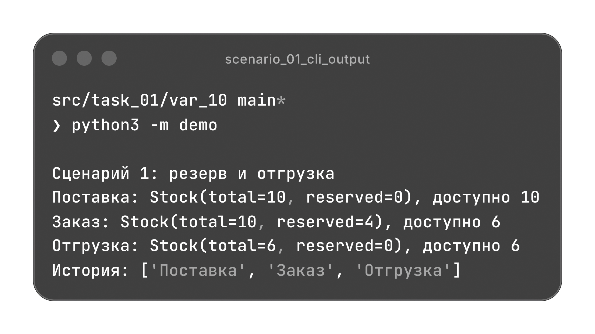
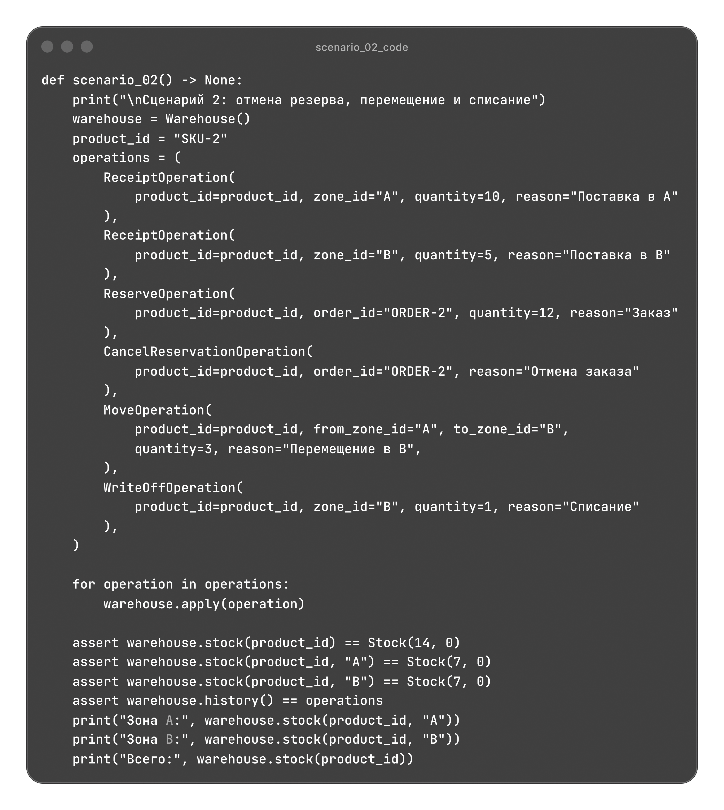
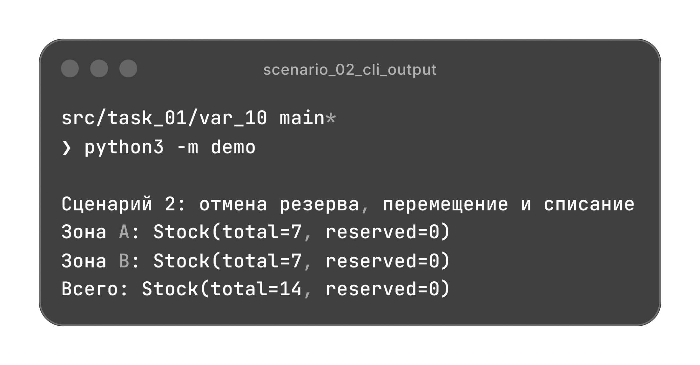
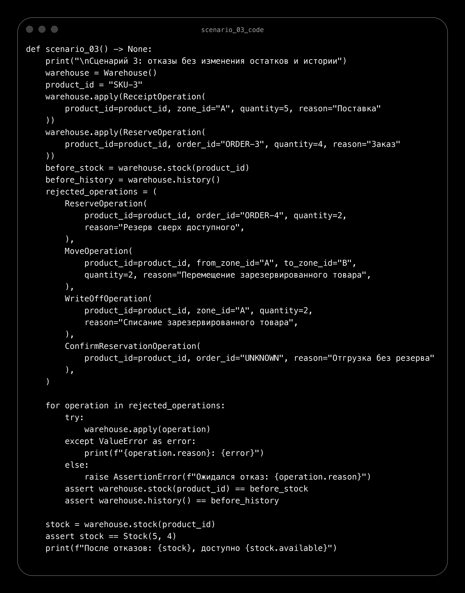
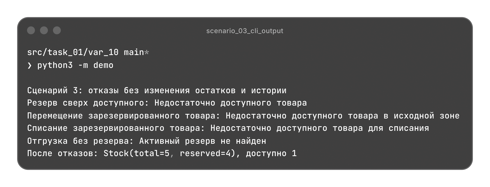

# Управление складскими операциями

Поступление, резервирование, отгрузка, перемещение и списание товаров. Остатки вычисляются из истории с указанием причины каждого изменения.

[Архитектура](#архитектура) | [Сценарии](#сценарии)

## Архитектура

| Файл | Назначение |
| --- | --- |
| [models.py](./models.py) | Снимок остатков, рабочее состояние и складские операции. |
| [validate.py](./validate.py) | Проверки данных, резервов, зон и целостности остатков. |
| [main.py](./main.py) | Применение операций, хранение истории и восстановление остатков. |
| [demo.py](./demo.py) | Три независимых сценария с проверкой результатов. |

### Модели

Модели используют `dataclass`. `Stock` является неизменяемым снимком, а `StockState` создается заново для расчета и изменяется операциями.

| Класс | Данные |
| --- | --- |
| `Stock` | Общее количество `total` и резерв `reserved`; доступное количество вычисляется как `total - reserved`. |
| `StockState` | Остатки по товару и зоне, активные резервы по товару и заказу. |

Снимок проверяет условие `0 <= reserved <= total`. Остаток можно получить по всем зонам или по одной выбранной зоне.

### Складские операции

`StockOperation(ABC)` объявляет метод `apply(state)` через `@abstractmethod`. Каждая операция содержит `product_id` и `reason`, аргументы передаются по имени. Операции описаны неизменяемыми `dataclass`.

| Операция | Изменение |
| --- | --- |
| `ReceiptOperation` | Добавляет товар в выбранную зону. |
| `ReserveOperation` | Резервирует доступный товар под заказ, сохраняя общее количество. |
| `ConfirmReservationOperation` | Отгружает весь резерв и удаляет его. |
| `CancelReservationOperation` | Снимает резерв и восстанавливает доступное количество. |
| `MoveOperation` | Перемещает доступный товар между зонами, сохраняя общий остаток. |
| `WriteOffOperation` | Списывает доступный товар из выбранной зоны. |

Для поступления и списания по умолчанию используется зона `MAIN`. Резерв может включать несколько зон: товар берется в порядке их добавления в рабочее состояние. Для пары `(product_id, order_id)` допускается один активный резерв.

Это паттерн "Команда": новая операция реализует общий `apply()` без изменения `Warehouse`. Повторное применение к одинаковому исходному состоянию должно давать одинаковый результат, поскольку история используется для восстановления остатков.

### Валидация

`validate.py` не зависит от моделей и склада. Он проверяет непустые идентификаторы и причину, положительные целые количества, зоны, активные резервы и целостность состояния. `bool` не принимается как количество.

Перемещение и списание ограничены доступным количеством в исходной зоне. Нельзя повторно открыть активный резерв или подтвердить несуществующий. После операции проверяются остатки по зонам и распределение резервов.

Неверный тип операции вызывает `TypeError`, нарушения значений и условий вызывают `ValueError`.

### Склад и история

`Warehouse` описан через `dataclass` и хранит историю выполненных операций. История служит единственным источником данных об остатках: при расчете создается пустое рабочее состояние, затем операции применяются по порядку.

Новая операция попадает в историю только после успешного применения и проверки состояния. При отказе история и остатки сохраняются. `stock()` возвращает неизменяемый снимок, `history()` возвращает кортеж глубоких копий записей.

Методы Warehouse

| Метод | Результат |
| --- | --- |
| `apply(operation)` | Выполняет операцию и добавляет ее копию в историю после проверок. |
| `stock(product_id, zone_id=None)` | Остаток товара по всем зонам или по одной указанной. |
| `history()` | Копии успешных операций в порядке выполнения. |

## Сценарии

`demo.py` содержит три независимых сценария. Каждый сценарий создает собственные объекты и проверяет результаты через `assert`.

Импорты demo.py

### Поступление, резерв и отгрузка

На склад поступает `10` единиц товара, `4` резервируются под `ORDER-1`, затем резерв подтверждается.

| После операции | Всего | В резерве | Доступно |
| --- | --- | --- | --- |
| Поступление | 10 | 0 | 10 |
| Резервирование | 10 | 4 | 6 |
| Подтверждение резерва | 6 | 0 | 6 |

История содержит три операции с причинами "Поставка", "Заказ" и "Отгрузка".

Код scenario_01()

### Отмена резерва и работа с зонами

В зону `A` поступает `10` единиц, в зону `B` поступает `5`. Резерв из `12` единиц распределяется между зонами и отменяется. Затем `3` единицы перемещаются из `A` в `B`, а `1` единица списывается в `B`.

В каждой зоне остается по `7` единиц, всего `14`, активных резервов нет. История содержит шесть операций.

Код scenario_02()

### Отказы без изменения склада

Из `5` единиц товара `4` зарезервированы. Отклоняются резервирование еще `2` единиц, перемещение и списание по `2` единицы, а также подтверждение несуществующего резерва.

После отказов всего `5` единиц, в резерве `4`, доступна `1`. В истории остаются две успешные операции.

Код scenario_03()

